# Задание на 17.10 по системному программированию: Развертывание окружения в WSL

**Выполнил:** Травкин М. Г.
**Пользователь Linux:** travkin-m-g

## 1. Установка WSL и Ubuntu

Установлены компоненты WSL и платформа виртуальной машины.
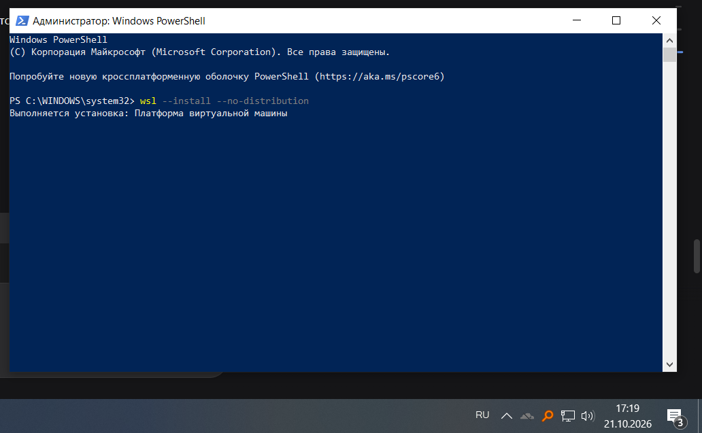
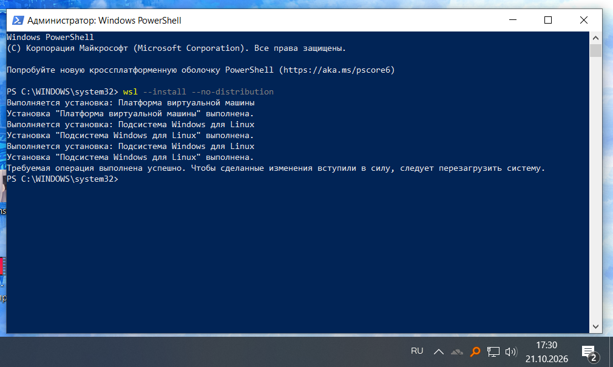

Выполнено переключение на вторую версию WSL.
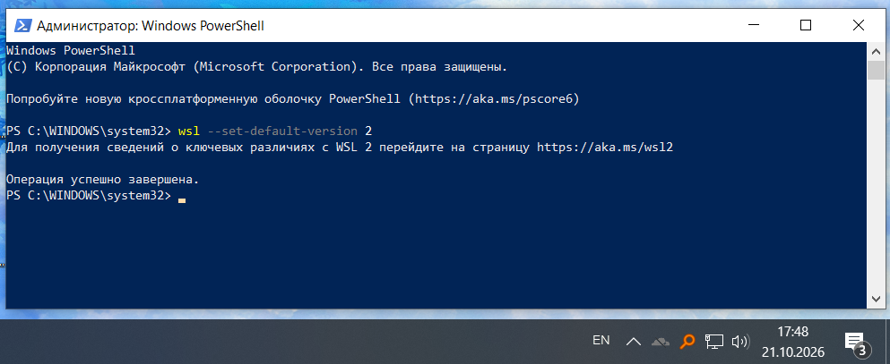

Дистрибутив Ubuntu 24.04 импортирован на диск D.
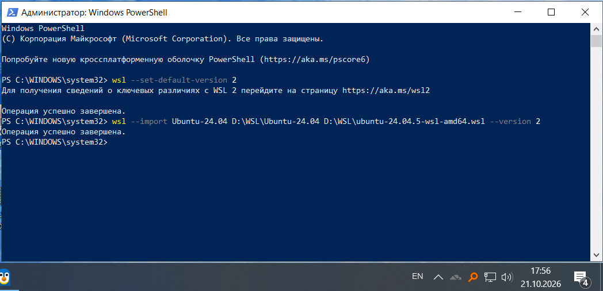

Стартовое окно документации WSL после установки.
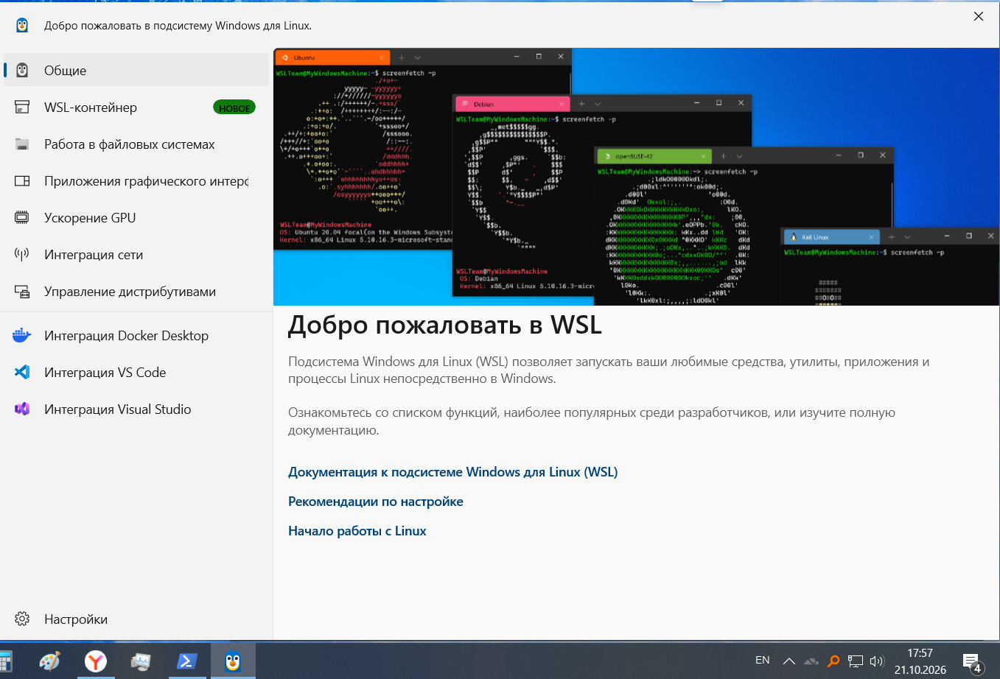

Первый запуск системы под пользователем `root`.
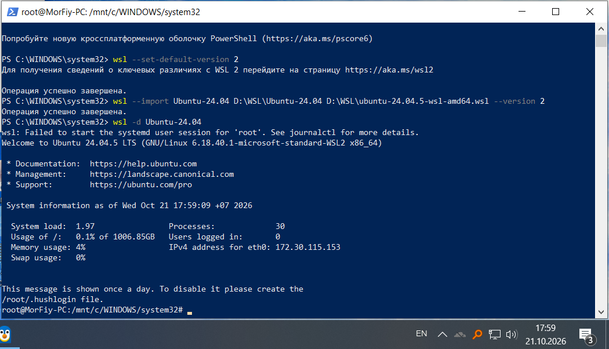

## 2. Настройка пользователя

Создан пользователь `travkin-m-g` и ему выданы права администратора.
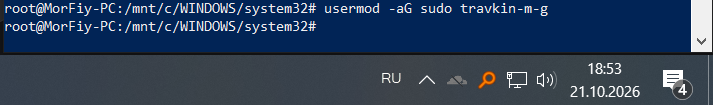

Настроен файл `wsl.conf` для автоматического входа под пользователем `travkin-m-g`.
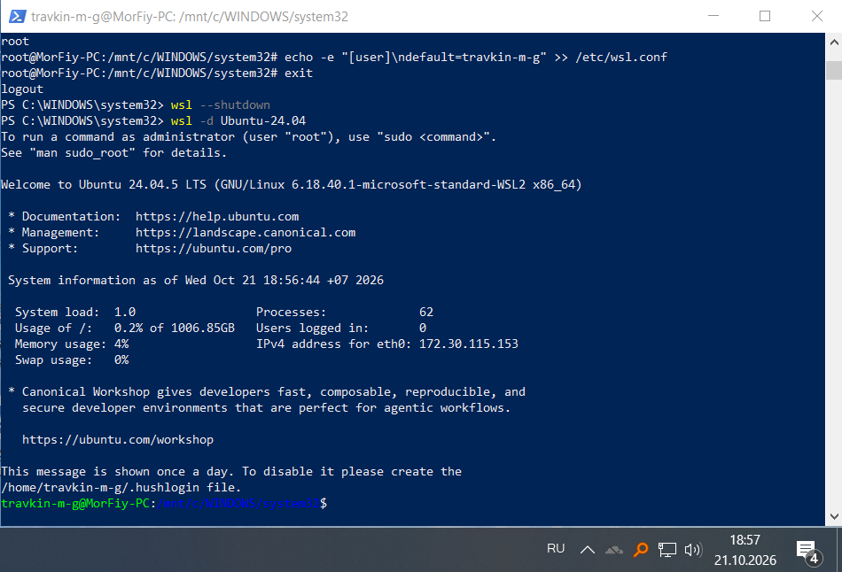

Проверка работы `sudo` и обновление списков пакетов системы.
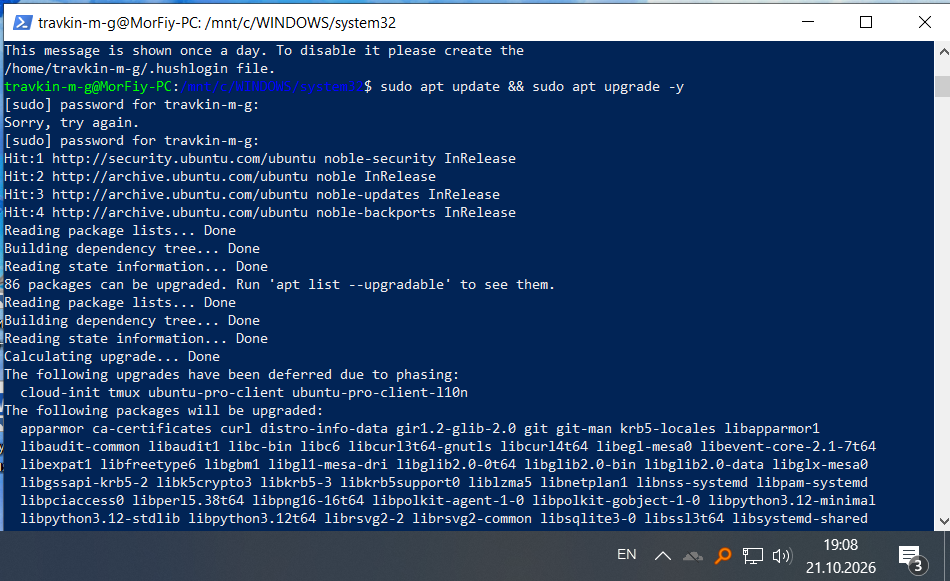
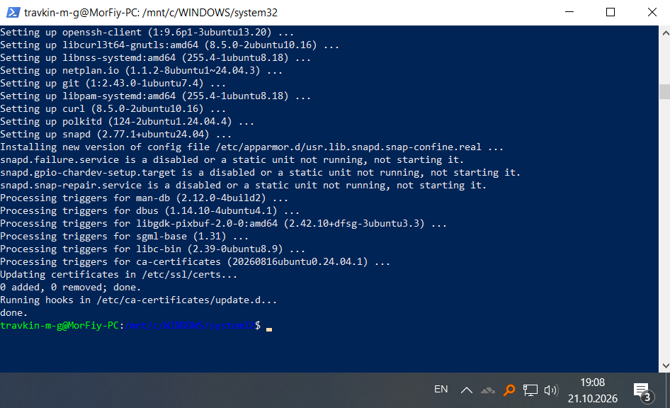

## 3. Установка компилятора (SDK)

Установлен пакет `build-essential` (компиляторы GCC, G++).
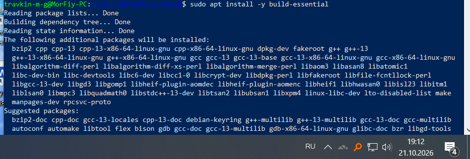
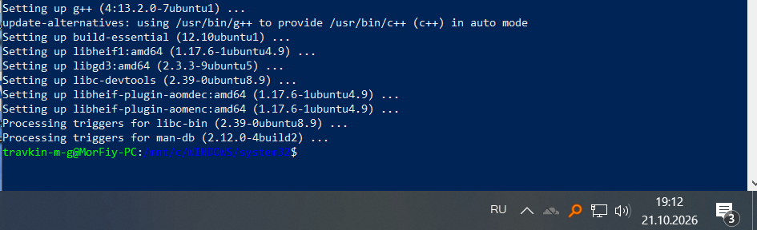

Проверка версии компилятора.
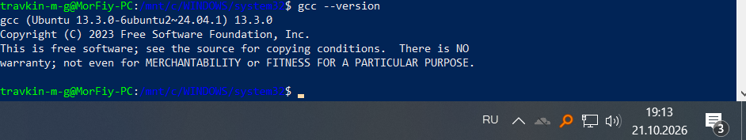

## 4. Установка PostgreSQL

Установлен сервер базы данных PostgreSQL и дополнительные утилиты.
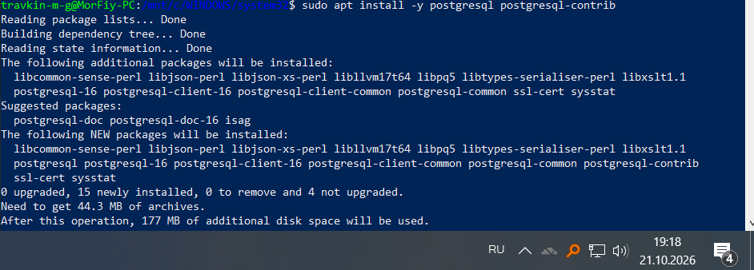
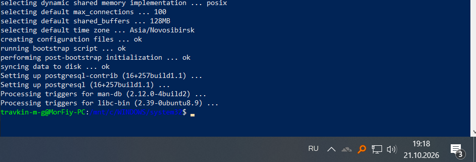

Проверка версии установленного клиента.
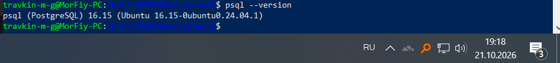

Запуск службы и проверка её статуса.
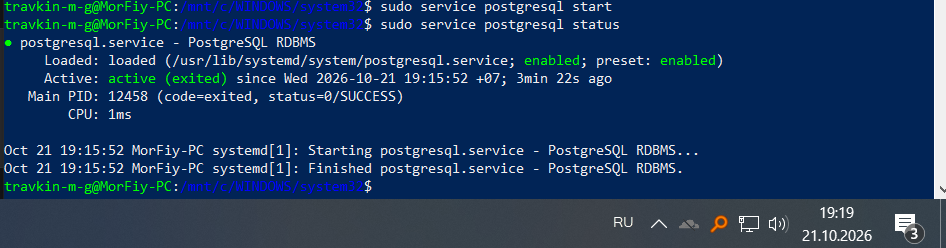

## 5. Создание базы данных

Вход в консоль PostgreSQL под системным пользователем.
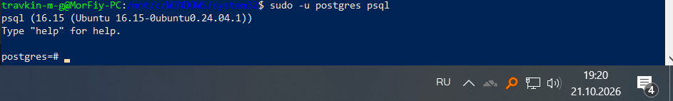

Создание тестовой базы данных `testdb`.
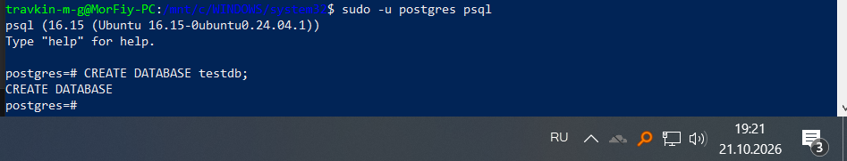

Попытка подключения по TCP-протоколу выявила отсутствие пароля.
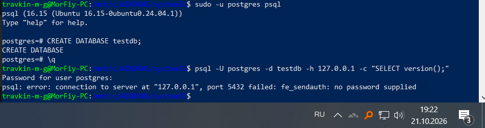

Установка пароля для пользователя `postgres`.
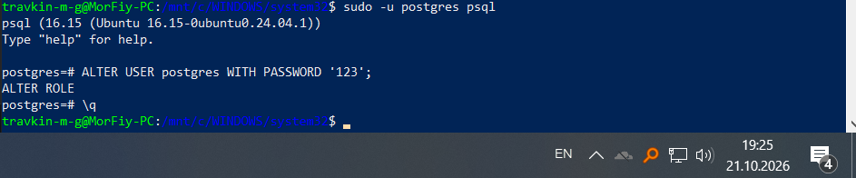

Финальная проверка: успешное подключение к базе данных и вывод версии СУБД.
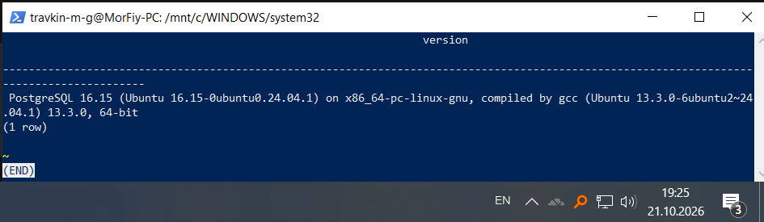
